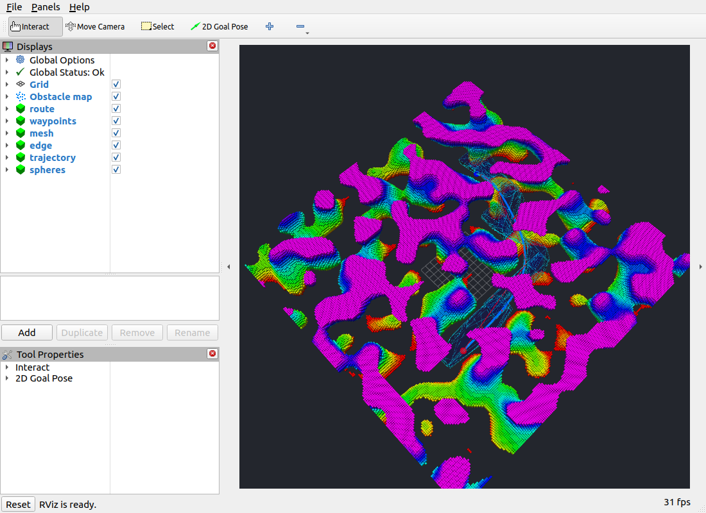
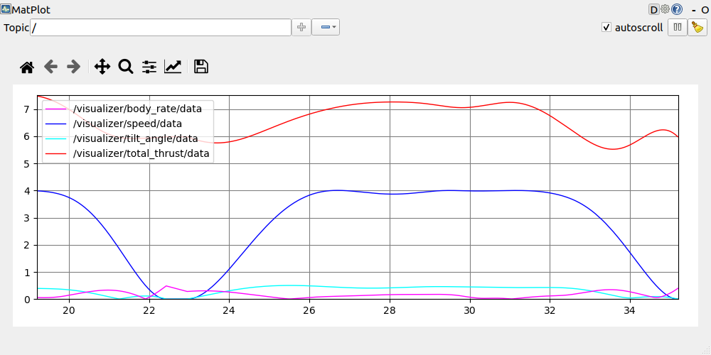

# 验证记录

验证日期：2026-09-28。验证对象是规划和参考轨迹回放，不是闭环飞行动力学仿真。

## 本机环境与结果

- Ubuntu 22.04 x86_64、ROS 2 Humble、C++17 Release、系统 Python 3.10。
- 本机 OMPL 1.5.2 从 Ubuntu 官方 libompl-dev/libompl16 软件包解包到用户目录；没有修改系统库。
- 从空 build/install 目录完成 `colcon build`，两个包构建成功；安装后的 launch、配置、节点和验证脚本均能找到。
- `colcon test-result --verbose`：**8 tests, 0 errors, 0 failures, 0 skipped**（colcon 汇总含测试套件条目，代码中为 3 个 GTest case、3 个 pytest case）。
- 自动测试启动真实 ROS 节点，覆盖障碍地图、空地图、不可达目标后恢复、重复规划、错误点云及选点、非法参数、晚订阅、四类地图和 launch 子进程退出。
- 四种地图生成测试分别收到 911、144、792、924 个点；这些是小尺寸固定测试场景，不是默认桌面地图。

固定场景的五条有效轨迹总时间为 3.77～4.88 s，终点误差最大约 `3.6e-15 m`，五类动态约束采样超限值均为 0。详细值见 [自动场景记录](validation/local-results.json)。不可达场景会先失败，再在同侧选点完成恢复规划。

## 桌面验收

实际在本机显示环境打开 RViz2 和 rqt_plot，使用原版 seed=1024、50×50×5 m、0.25 m 体素的随机地图（239999 个点），完成：

1. RViz2 2D Goal Pose 鼠标选点；障碍内输入被拒绝后重新选择。
2. 两次正反向规划、走廊和轨迹显示、球体完整回放，均收到 `COMPLETED`。
3. RViz2 Global Status 为 OK；rqt_plot 收到速度、总推力、倾角、机体角速度四条曲线。
4. SIGINT 退出 launch 后，地图、规划、TF、RViz2、rqt_plot 五个进程均正常结束。

鼠标选点两次轨迹的日志：[desktop-mouse.log](validation/desktop-mouse.log)。

| 项目 | 第一次 | 第二次（反向） |
|---|---:|---:|
| 轨迹总时间 | 12.723024 s | 13.052953 s |
| 终点误差 | 8.88e-16 m | 8.88e-16 m |
| 最大速度超限 | 0.000560159 m/s | 0.00643582 m/s |
| 角速度、倾角、推力上下限超限 | 0 | 0 |
| 0.01 s 占用采样检查 | 通过 | 通过 |

另通过自动目标发布器，在同一原版随机地图验证正反向规划、所有可视化话题和终点球体位置，截图如下。截图来自真实应用窗口；曲线来自参考轨迹，单位分别为 m/s、N、rad、rad/s。





原随机地图可复现命令（先保持主 launch 运行，在另一个终端执行）：

```bash
source scripts/env.sh
ros2 run gcopter verify_demo.py --attach \
  --start -13.125 -10.625 2.625 --goal 9.875 9.875 2.625
```

两个终端应使用相同 ROS_DOMAIN_ID。OMPL 按时间预算停止，不同机器、线程负载和 OMPL 版本的路径及超限数值可能变化。

## 验证边界

数值检查以不超过 0.01 s 的时间间隔检查位置、速度、加速度、jerk、平坦映射状态和膨胀地图占用，并包含终点。它是**离散检查，不是连续时间碰撞或动力学可行性的证明**。速度等使用软罚项，随机地图中观察到的少量超限如实保留。

本次没有实现或验证 PX4、Gazebo、无人机动力学积分、控制器、传感器反馈或动态障碍重规划。RViz2 的球体不是受控制器驱动的飞机。

GitHub Actions 的实际结果通过[工作流页面](https://github.com/hsc13576717115/GCOPTER-ros2/actions/workflows/humble.yml)查看；本文件中的桌面结果由本机验收补充。
